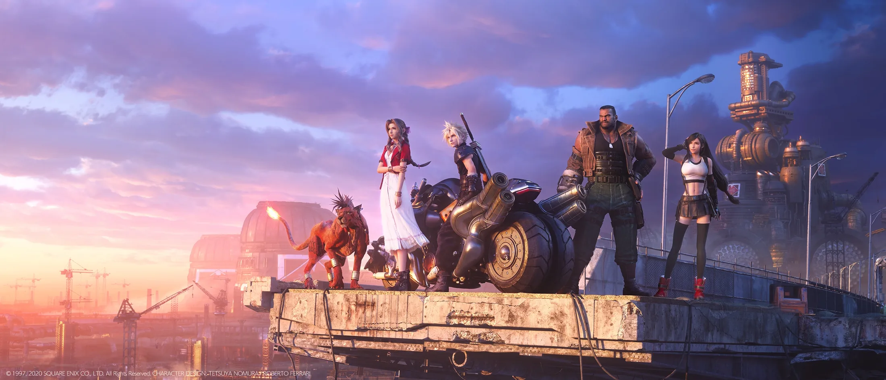

<p align="center">
  
  <br>
  <sub><i>Final Fantasy VII Remake</i> key art © Square Enix</sub>
</p>

<h1 align="center">FINAL FANTASY VII · TIMELINE ANALYZER</h1>

<p align="center"><i>One story. Two tellings. Every difference, cited.</i></p>

<p align="center">
  
  
  
  
  
</p>

A fan-made guide to how _Final Fantasy VII_'s story is told across the 1997 original and the Remake series: what each game shows, what it changes, how everyone is connected, and where the two tellings part ways. It is written for someone meeting the story for the first time, and every fact says where in the game to see it.

---

## ☞ Party

The four games, as the home menu lines them up.

| Member                                                 | LV   | In the archive                                                   |
| ------------------------------------------------------ | ---- | ---------------------------------------------------------------- |
| **Final Fantasy VII**                                  | 1997 | The whole original story: 39 parts across 3 discs                |
| **Final Fantasy VII Remake**                           | 2020 | 18 chapters, from Mako Reactor 1 to the Shinra Building          |
| **Final Fantasy VII Remake Intergrade — INTERmission** | 2021 | Yuffie's 2 chapters, a new story beside the first                |
| **Final Fantasy VII Rebirth**                          | 2024 | 14 chapters and an interlude, from Kalm to the Forgotten Capital |

**115** characters, moments, places and groups · **275** appearances · **405** links — each checked against the games themselves.

## ☞ Command

| Command        | What awaits                                                                                |
| -------------- | ------------------------------------------------------------------------------------------ |
| **Timeline**   | The story top to bottom, chapter by chapter; open a moment to see how each game tells it   |
| **Compare**    | What the Remake Trilogy changes, moment by moment, or any two things side by side          |
| **Divergence** | Pick a turning point: the story so far on a line of Mako light, then where each game goes  |
| **Network**    | A web of materia — people, moments, places, groups — and the chain that links any two      |
| **Explore**    | Who's who and what's what, as picture cards                                                |
| **Archive**    | Each game chapter by chapter, and who and what each one shows                              |
| **Config**     | Background music, motion, the title screen, the Buster Sword cursor and the spoiler notice |

Around them: a title screen over Midgar at night, a home menu in the original's pause-menu style that answers to the arrows or W A S D, the original's blue window between sections, the soundtrack playing on from page to page, and 143 official pictures behind every screen. The full look is in [`docs/design.md`](docs/design.md).

## ☞ Materia

| Slot     | Equipped                                                                                          |
| -------- | ------------------------------------------------------------------------------------------------- |
| Web      | React 19, Vite, React Router, Tailwind CSS, TanStack Query, Zustand, Cytoscape                    |
| API      | Fastify, Zod, OpenAPI                                                                             |
| Data     | Hand-written YAML in [`data/`](data/) — the source of truth — seeded into PostgreSQL with Drizzle |
| Tests    | Vitest, Playwright, axe-core                                                                      |
| Language | TypeScript throughout, run natively on Node 24, in a pnpm monorepo                                |

## ☞ Save point

Needs Node 24, pnpm and Docker.

```bash
pnpm install
cp .env.example .env
pnpm db:up && pnpm db:migrate && pnpm db:seed
pnpm api:dev    # http://localhost:3000/docs
pnpm web:dev    # http://localhost:5173
```

| Command         | What it does                                                            |
| --------------- | ----------------------------------------------------------------------- |
| `pnpm check`    | Types, lint, format, unit tests and data validation                     |
| `pnpm test:db`  | Database and API tests (after `pnpm db:up`)                             |
| `pnpm e2e`      | Build the site and run the Playwright journeys and accessibility audits |
| `pnpm web:size` | Keep the first load under its size budgets                              |
| `pnpm validate` | Check `data/` against every rule in the docs                            |
| `pnpm db:reset` | Rebuild the database from scratch                                       |

After changing the API, run `pnpm api:types`; after a schema change, `pnpm db:generate`; after a Zod schema change, `pnpm schemas`. [CI](.github/workflows/ci.yml) runs all of the above, plus the API's Docker build, on every push.

## ☞ World map

```
apps/
  web/          the site
  api/          read-only REST API
  e2e/          Playwright journeys and axe audits
packages/
  shared/       schemas, titles, chronology, statuses, divergence
  data/         loads and validates data/
  db/           PostgreSQL schema, seeding and queries
  graph-core/   paths, groups and centrality for the network
data/           every fact, as YAML, with the research log
docs/           the model, the design and the decisions
```

## ☞ Deploy

- **API:** a Docker image ([`apps/api/Dockerfile`](apps/api/Dockerfile)) that applies migrations and reseeds from the bundled `data/` on start, hosted on Render from [`render.yaml`](render.yaml) with a Neon Postgres database ([decision 0006](docs/decisions/0006-api-design.md)).
- **Site:** a static build on Vercel ([`apps/web/vercel.json`](apps/web/vercel.json)), with `VITE_API_URL` pointing at the API ([decision 0007](docs/decisions/0007-web-app.md)).

Step by step, from nothing to a live site: [`docs/deploy.md`](docs/deploy.md).

## ☞ Canon

Each game is its own canon; where they disagree, that's a difference to show, never a contradiction to settle. A fact goes in only once it has been checked against the game — by playing it, from recorded footage, or from its script — and it carries where in the game to see it. Fan wikis are used only to find things, never as proof, and anything a game only shows without saying waits for a footage check. The sources used and the questions still open live in [`data/research/`](data/research/); the rules are in [`docs/canon-and-sources.md`](docs/canon-and-sources.md), and the whole model in [`docs/`](docs/README.md).

## ☞ Credits

- **Final Fantasy VII**, **Remake**, **Intergrade**, **Rebirth** and **Crisis Core** — their names, characters, stories and logos — © **Square Enix**.
- **Artwork:** every picture is official Square Enix material — key art, character art by Tetsuya Nomura and Roberto Ferrari, concept art, in-game stills and promo shots; the logo illustration is by Yoshitaka Amano. Each is credited, with its source on the [Final Fantasy Wiki](https://finalfantasy.fandom.com), on the site's Credits page. None is AI-made.
- **Music:** © **Square Enix**. Composed by **Nobuo Uematsu**, with **Takeharu Ishimoto** for _Crisis Core_ and **Masashi Hamauzu** and the Remake series' arrangers — Yasunori Nishiki, Shotaro Shima, Yoshitaka Suzuki, Tadayoshi Makino, Kenichiro Fukui, Ryo Furukawa and Tsutomu Narita. Each track's credits are shown in Config.
- **Lettering:** the series' logo lettering by Juan Pablo Reyes Altamirano, Optimus Princeps by Manfred Klein, [Reactor7](https://caveras.net/) by Caveras (CC BY-NC-SA, licence in [`apps/web/public/fonts/reactor7/`](apps/web/public/fonts/reactor7/)), Inter and JetBrains Mono.
- **Cursor:** Cloud's Buster Sword from [Cursors-4U](https://www.cursors-4u.com/cursor/final-fantasy-7-cloud-s-buster-sword).

The full list is in [`LICENSE`](LICENSE). Any picture or track will be taken down at the rights holder's request.

## ☞ Licence

- **Code:** [MIT](LICENSE).
- **Data and docs** (`data/`, `docs/`): [CC BY-NC 4.0](LICENSE-DATA) — reuse with credit, not for profit.

These cover only the original work here, never Square Enix's.

<p align="center"><sub>A non-commercial fan project. Not affiliated with or endorsed by Square Enix.</sub></p>
